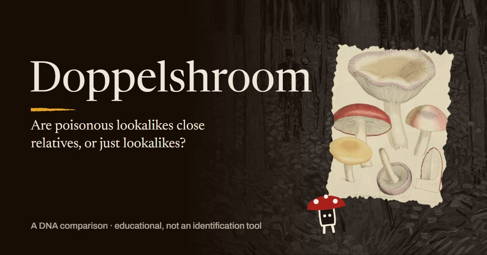

# Doppelshroom 🍄

[](https://github.com/arjunmenontiwari/doppelshroom/actions/workflows/tests.yml)

**Are poisonous mushroom lookalikes close relatives of the edible ones, or do they just look alike?**
Doppelshroom answers that with DNA barcodes, for any mushroom you can name.



> ⚠️ **Educational project, not an identification tool.** Never eat a wild mushroom because a website, an app or an AI said so. Ask an expert, in person.

## The answer, in numbers

Across **682 lookalike pairs** from **72 of the most-observed mushrooms** on iNaturalist:

- 🧬 **Lookalikes are closer relatives than chance.** 55% share a genus or family, against 2% of random pairs (permutation test, p < 0.001).
- 🔍 **The more people mix two species up, the closer their DNA tends to be** (Spearman ρ = −0.23, p < 0.001).
- 🎭 **But 45% of lookalikes aren't even in the same family.** Nearly half of all doubles evolved their look separately. Many doubles are just doubles.
- 🏷️ **36 of 72 species have a barcode gap**: their ITS barcode alone tells them apart from every lookalike on record. Chanterelles are the troublemakers, since their own barcodes vary wildly.

The full charts live on the site's Analysis page, and `analyze.py` reproduces them.

## What it does

| | |
|---|---|
| **Search** | Any mushroom by name, by description (*"orange funnel, pine forest, Scotland"*), by place, or near you |
| **Species pages** | Photos, AI-written quick facts, lookalikes ranked by how often people confuse them, DNA difference for each, and a family tree |
| **Compare** | Any two species side by side: their barcodes letter by letter (ITS1, 5.8S, ITS2), seasons and world maps |
| **Lens** | Upload a photo to see what it might be and, more importantly, what dangerous species it could be confused with |
| **DNA lens** | Paste a DNA sequence and a k-mer search finds the closest species among the barcodes the site holds |
| **Analysis** | The statistics above, with interactive charts |
| **Quiz** | Real photo or lookalike? Keeps your best streak |
| **Dopple** | A small toadstool who walks along the bottom of the screen as you scroll and has opinions about every page. Click him. |

## How it works

1. **DNA barcodes.** Every fungus has an ITS region, the official fungal barcode. Doppelshroom fetches it from NCBI GenBank.
2. **Alignment.** Two barcodes are lined up with a global pairwise alignment (Biopython), trying both DNA strands.
3. **Distance.** Kimura 2-parameter distance, the barcoding standard, which corrects for letters that changed more than once. The site shows plain "% different" figures to readers.
4. **Trees.** Neighbour-joining trees of each species and its lookalikes, rooted at the midpoint.
5. **Lookalikes.** Taken from iNaturalist's corrected identifications: the species people actually mistook for each other.
6. **Statistics.** Permutation tests that only shuffle within one focal species, the idea behind a Mantel test, so pairs sharing a species don't count twice.
7. **DNA lens.** A pasted sequence is cut into every 8-letter k-mer, references are ranked by shared k-mers on both strands, and the best few are aligned for an exact identity.

## Safety rules, built into the code

- Edible and poisonous labels come from a hand-checked list (`species.csv`) or a Wikipedia infobox, **never from AI**. When the infobox lists several values, the most dangerous one wins.
- The photo lens and the DNA lens **never say "edible"**. They point at dangerous lookalikes instead.
- Recipe links (never AI-written steps) appear only for species labelled edible with no warnings, found through name search, and the server enforces that too.
- `tests/test_safety.py` fails if any of this breaks.

## Run it yourself

```bash
python -m venv .venv
source .venv/bin/activate       # Windows: .venv\Scripts\activate  (Git Bash: source .venv/Scripts/activate)
pip install -r requirements.txt
uvicorn app:app --port 8000     # then open http://127.0.0.1:8000
```

The AI features (describe search, photo lens, quick facts) need a free [Gemini API key](https://aistudio.google.com/apikey) in a `.env` file:

```
GEMINI_API_KEY=your-key-here
```

Everything else works without one.

```bash
pip install -r requirements-dev.txt
pytest                          # 23 tests, offline, under a second
python analyze.py               # rebuild analysis.json (slow the first time: it downloads a few hundred barcodes)
```

Live lookups are cached in `cache/`, so each question is asked of the outside databases only once.

## Under the hood

- **Backend:** Python, FastAPI and Biopython. `app.py` holds the routes, `lookup.py` the live lookups and the k-mer search, and `build_tree.py` the alignment and K2P distance.
- **Frontend:** plain HTML, CSS and JavaScript, with no framework and no build step. Leaflet draws the maps.
- **Design:** hand-coloured fungus plates by James Sowerby (1797–1815), forest paintings by Van Gogh, Monet and Courbet, and a generated washi-paper texture. All the art is public domain.
- **Privacy:** no cookies, no analytics, and fonts served from the site itself. Locations are rounded to about 10 km and never stored.
- **CI:** GitHub Actions runs the tests on every push.

## Data and credits

[NCBI GenBank and Taxonomy](https://www.ncbi.nlm.nih.gov/) · [iNaturalist](https://www.inaturalist.org/) (photos under their Creative Commons licences, credited on each page) · [GBIF](https://www.gbif.org/) · [Wikipedia](https://www.wikipedia.org/) (CC BY-SA) · [Google Gemini](https://ai.google.dev/) · Fonts: Newsreader, Archivo and Gaegu (SIL OFL). Full credits are on the site's Sources page.

## Licence

The code is under the [MIT License](LICENSE). Data, photos, text, fonts and artwork keep their own licences, listed under *Data and credits* above and on the site's Sources page.

## Who made this

Built by **Arjun Menon Tiwari**, a computer science student at the University of Helsinki with a minor in chemistry. It's a bioinformatics portfolio project.

Found a bug, or a mushroom that's misbehaving? [Open an issue](https://github.com/arjunmenontiwari/doppelshroom/issues) or say hi on [LinkedIn](https://www.linkedin.com/in/arjun-menon-tiwari-22bb63299/).

*Dopple says: "don't eat me. i'm a looker, not a snack."*
